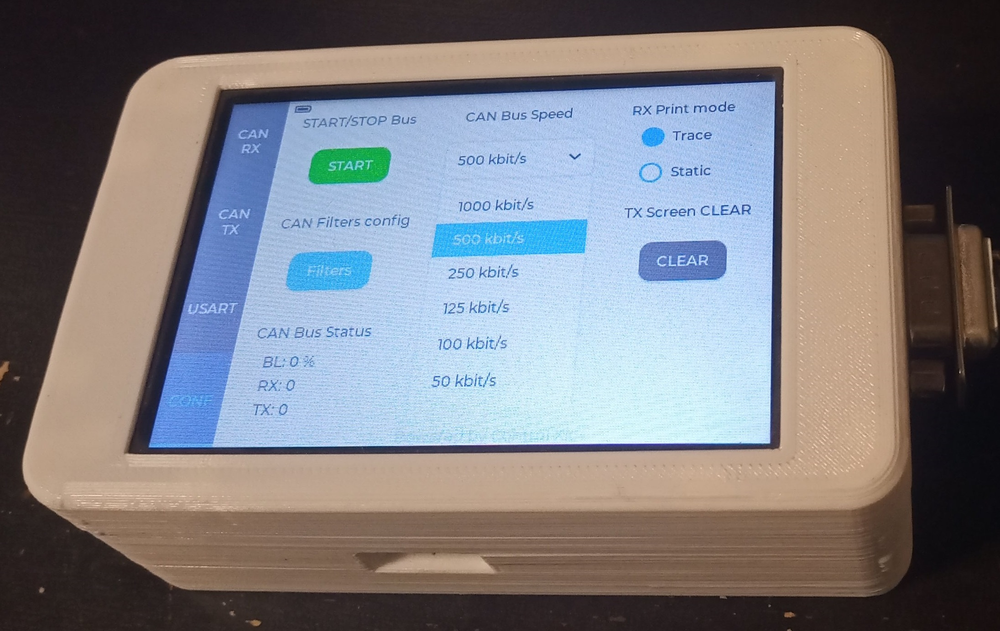
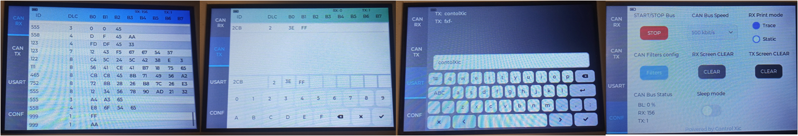

# Control Xic CANFD Tool

-STM32G474RET6 MCU
-ST7796S TFT 480x320
-TP FT6336

A pocket-sized device for monitoring and transmitting CAN frames.

Developed using **LVGL 9.2**, **STM32CubeIDE**, **KiCad**

## Overview

The original goal of this research project was to develop a portable device capable of visualizing CAN FD frames on a 4-inch display.

The device provides the following features:

- **RX monitoring:** View received CAN frames.
- **TX transmission:** Transmit CAN frames.
- **Bitrate configuration:** Configure the bus bitrate (kbit/s).
- **RX display modes:** Choose between Trace and Static modes.
- **CAN filters:** Configure up to four CAN filters.
- **Bus statistics:** Monitor CAN bus statistics.
- **USB Serial interface:** Read and write data through a USB serial port (8N1, 115200 baud).

Device     
  

Screens  

## Hardware and Design Notes

**CAN FD support was ultimately dropped** due to limitations related to the display size and overall user experience.

This project is based on an earlier hardware iteration that used a 4-inch Raspberry Pi display together with adapted libraries. This explains some of the design decisions behind the current PCB.

The original display's touchscreen was in poor condition, so it was replaced with an **MSP4030/4031 display**.

### Potential Improvements

There are several aspects of the hardware design that could be improved in a future revision:

- **PCB redesign:** A new PCB layout could make the device more compact. In particular, the overall Z-axis dimension could be reduced by approximately 10 mm.
- **Power switch placement:** The current position of the power switch is not ideal. As a result, the battery continues to drain even when the device appears to be switched off. This should be addressed in a future hardware revision.

- **Final Capabilities:** Furthermore, the microcontroller is operating at the limit of its capabilities—it is able to read CAN data with the bus at 100% load while simultaneously rendering it to the display. It might be advisable to limit the graphics memory allocation in `lv_conf.h`. This limitation also causes a "curtain" effect (tearing/stuttering) during screen refreshes, though it is not particularly distracting to the eye. 

- It is worth noting that reading and writing have been verified using professional tools such as PCAN, Kvaser, and CANoe. 

## Acknowledgements

Special thanks to [@lvgl](https://github.com/lvgl) for their excellent open-source work and for making LVGL available to the community.
